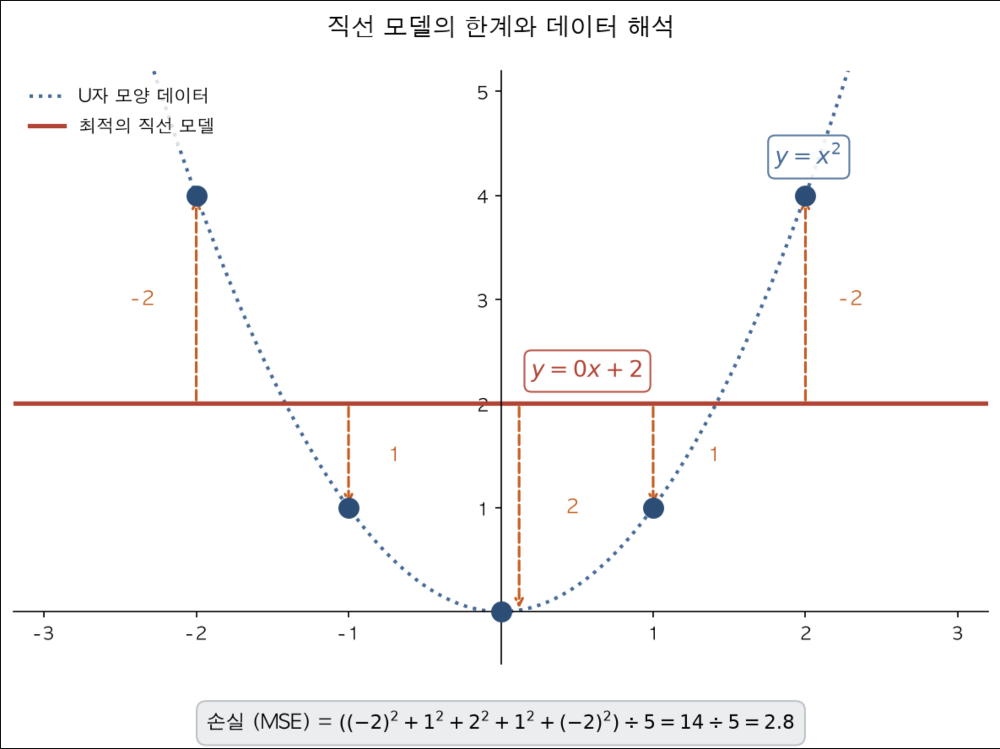
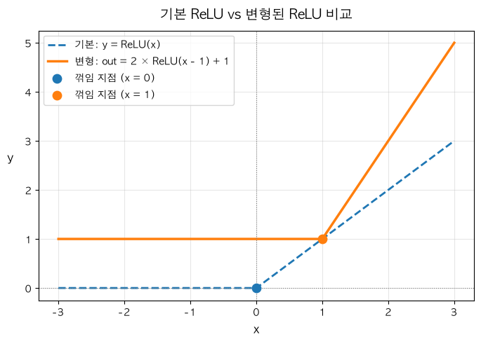

### 1. 직선 모델의 한계



**[ y = x² ]**

| 구분 | **x = -2** | **x = -1** | **x = 0** | **x = 1** | **x = 2** |
|---|---|---|---|---|---|
|  **`y`** | 4 | 1 | 0 | 1 | 4 |

- x가 음수일때는 기울기가 음수이고 x가 양수일때는 기울기가 양수이므로 기울기가 상쇄되어 기울기 w는 0이 된다.
- w가 0일때 y =0 * x + b 가 되어 b는 y값의 평균인 2가 되어 y = 0 * x + 2 가 된다.

```
예측 = 2, 2, 2, 2, 2
오차(예측 − 정답) = −2, 1, 2, 1, −2
손실(MSE) = (4 + 1 + 4 + 1 + 4) ÷ 5 = 2.8
```
- **1차함수(직선)의 한계**: 직선은 모든 x에서 기울기가 `w` 하나로 고정되어 있어서 곡선을 그릴 수 없다.

### 2. ReLU : 직선을 꺾을 수 있는 도구

- **`ReLU`** :  
  `값` > 0 이면 `값`  
  `값` <= 0 이면 0  

```
ReLU(z) = max(0, z) # z > 0 이면 z / z <= 0 = 0
```

```python
import torch

z = torch.tensor([-3., -0.5, 0., 2., 4.])
print(torch.relu(z))
```

```
tensor([0., 0., 0., 2., 4.])
```

- 그래프로 그리면 왼쪽은 평평하고 0에서 꺾여 오른쪽은 올라가는 선이다. 기울기가 `0`에서 `1`로 바뀌는 **꺾임**이 핵심이다.
- `ReLU`를 끼우면 직선이 꺾인 선이 된다.

**ReLU 변형하기**

| 구분 | **x = -2** | **x = -1** | **x = 0** | **x = 1** | **x = 2** |
|:---:|:---:|:---:|:---:|:---:|:---:|
| **`z = x − 1`** | -3 | -2 | -1 | 0 | 1 |
| **`h = ReLU(z)`** | 0 | 0 | 0 | 0 | 1 |
| **`out(변형) = 2 × h + 1`** | 1 | 1 | 1 | 1 | 3 |



- `x`가 1 이하이면 `z = x − 1`이 0 이하이므로 `ReLU`가 0으로 만든다.  
  그러면 `h = 0`이고 `out = 2 × 0 + 1 = 1`로 `x`가 1 이하일 때 `out`은 항상 1이다.  
- `x`가 1보다 크면 `z`가 양수이므로 `ReLU`를 그대로 통과한다.  
  그러면 `h = z`이고 `out = 2 × (x − 1) + 1`로 `x`가 1 증가하면 `out`은 `2`씩 증가한다.  
- `ReLU`는 입력이 0일 때 꺾이는데 입력이 `x − 1`이므로, `x = 1`에서 꺾인다.
- 꺾이는 지점을 여러 개 만들면 U자 같은 모양도 만들 수 있다.

### 3. MLP: Linear → ReLU → Linear

```
입력 x → Linear → ReLU → Linear → 예측
```

- 첫 번째 `Linear`: 입력에서 여러 개의 `z`를 만든다.
- `ReLU`: 각 `z`를 꺾는다. (음수는 0)
- 두 번째 `Linear`: 꺾인 값들을 합쳐 최종 예측을 만든다.

**직접 정한 값으로 U자 만들기**

- 첫 번째 `Linear(1, 2)`: `z₁ = x`, `z₂ = −x` 가중치 w1 = 1, 가중치 w2 = -1
- `ReLU`: `h₁ = ReLU(x)`, `h₂ = ReLU(−x)`
- 두 번째 `Linear(2, 1)`: `예측 = 1.5 × h₁ + 1.5 × h₂` 가중치 w3, w4 = 1.5

| 구분 | **x = -2** | **x = -1** | **x = 0** | **x = 1** | **x = 2** |
| :--- | :---: | :---: | :---: | :---: | :---: |
| **`z₁ = x`** | -2 | -1 | 0 | 1 | 2 |
| **`z₂ = −x`** | 2 | 1 | 0 | -1 | -2 |
| **`h₁ = ReLU(z₁)`** | 0 | 0 | 0 | 1 | 2 |
| **`h₂ = ReLU(z₂)`** | 2 | 1 | 0 | 0 | 0 |
| **`예측 (out)`** | **3** | **1.5** | **0** | **1.5** | **3** |
| **`정답 (y = x²)`** | **4** | **1** | **0** | **1** | **4** |

- `h₁`은 오른쪽만, `h₂`는 왼쪽만 올라가서 합치면 양쪽 끝이 높은 U자가 된다.
- 오차는 `−1, 0.5, 0, 0.5, −1`이고 손실은 `(1 + 0.25 + 0 + 0.25 + 1) ÷ 5 = 0.5`이다. 직선의 최선(`2.8`)보다 훨씬 작다.

```python
from torch import nn

class UShape(nn.Module):
    def __init__(self):
        super().__init__()
        self.layer1 = nn.Linear(1, 2)
        self.act = nn.ReLU()
        self.layer2 = nn.Linear(2, 1)

    def forward(self, x):
        z = self.layer1(x)
        h = self.act(z)
        return self.layer2(h)

model = UShape()
with torch.no_grad():
    model.layer1.weight.copy_(torch.tensor([[1.], [-1.]]))
    model.layer1.bias.zero_()
    model.layer2.weight.copy_(torch.tensor([[1.5, 1.5]]))
    model.layer2.bias.zero_()

x = torch.tensor([[-2.], [-1.], [0.], [1.], [2.]])
y = x ** 2
pred = model(x)
loss = ((pred - y) ** 2).mean()
print(pred.shape, f"{loss.item():.4f}")
```

```
torch.Size([5, 1]) 0.5000
```

- `nn.ReLU()`: `ReLU`를 층처럼 쓰는 도구이며 파라미터가 없다.

### 4. 층을 지나는 shape

- 입력 `x`가 `(4, 1)`이고 `Linear(1, 3)` → `ReLU` → `Linear(3, 1)`인 MLP를 보자.

| 단계 | shape | 이유 |
| --- | --- | --- |
| 입력 `x` | (4, 1) | 표본 4개, 특성 1개 |
| `Linear(1, 3)` → `z` | (4, 3) | 표본마다 값이 3개 |
| `ReLU` → `h` | (4, 3) | 값만 바뀌고 모양은 그대로 |
| `Linear(3, 1)` → `pred` | (4, 1) | 표본마다 값 1개로 합침 |

### 5. nn.Linear 등록과 forward호출

- `__init__`에서 `self.이름 = nn.Linear(...)`로 선언하면 **등록**은 자동으로 된다. 하지만 실제로 계산에 쓰이려면 `forward`에서 호출해야 한다.

```python
class Unused(nn.Module):
    def __init__(self):
        super().__init__()
        self.a = nn.Linear(1, 1)
        self.b = nn.Linear(1, 1)    # 등록

    def forward(self, x): 
        return self.a(x) # a만 호출

m = Unused()
loss = m(torch.tensor([[1.]])).sum()
loss.backward()

for name, p in m.named_parameters():
    print(name, p.grad is None)       # 기울기 존재 → False / 기울기 none → True
```

```
a.weight False
a.bias False
b.weight True
b.bias True
```

&nbsp;

&nbsp;

\- 이 글은 Codeit 강의를 수강하며 학습한 내용을 바탕으로 개인적으로 정리한 것입니다. ([Codeit 공식 사이트](https://codeit.kr/)) -
{: .small .text-muted .text-center }
