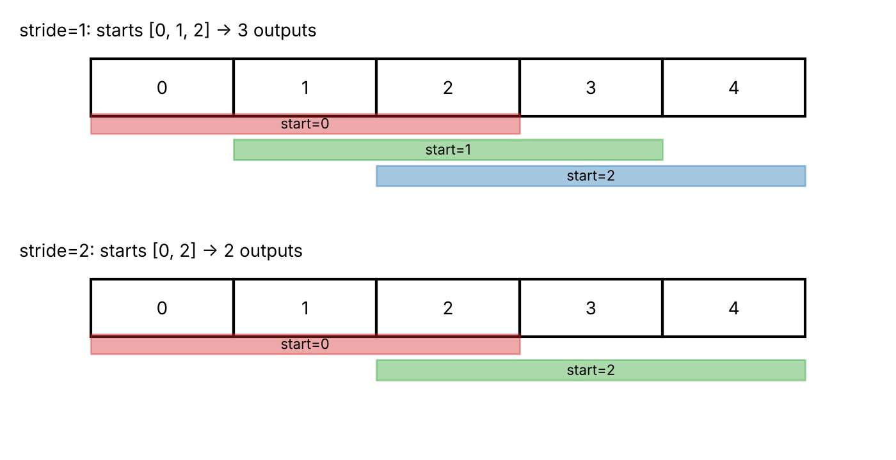
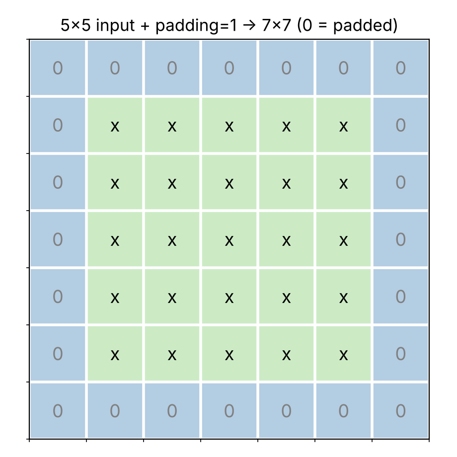
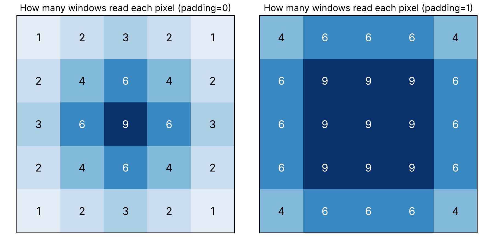

### 1. Stride : 필터를 옮기는 간격

- **stride**는 필터를 한 번에 몇 칸씩 옮기는지이다. 기본값은 1이다.
- stride는 "건너뛰며 읽는다"가 아니라 **다음 창을 놓는 위치**만 바꾼다. 창은 여전히 3×3 전체를 읽는다.

**📍 [예시] 한 축으로 보기 (입력 길이 5, 필터 길이 3)**



| stride | 필터 시작 위치 | 출력 길이 |
| --- | --- | --- |
| 1 | 0, 1, 2 | 3 |
| 2 | 0, 2 | 2 |

- stride 2에서 다음 시작 위치 4는 열 4~6이 입력을 벗어나서 계산하지 못한다.
- 행도 똑같이 세므로 5×5 입력에 stride 2이면 출력은 2×2이다.

### 2. Padding : 가장자리에 0 덧대기

- **padding**은 입력의 위·아래·왼쪽·오른쪽에 **0을 한 줄씩** 덧대는 것이다. padding=1이면 5×5가 7×7이 된다.
- 덧댄 0은 원래 있던 픽셀이 아니라 **계산용 값**이다.



**칸마다 몇 번씩 읽히는가 (5×5 입력, 3×3 필터, stride 1)**



- padding=0이면 모서리 칸은 창 **1개**에만 들어가고 한가운데 칸은 **9개**에 들어간다.
- padding=1이면 모서리 칸도 4개의 창에 들어가서 가장자리의 차이가 줄어든다.

- 7×7 위에서 3×3 필터를 stride 1로 옮기면 시작 위치가 가로 5곳, 세로 5곳이라 출력이 **5×5**로 입력 크기가 유지된다.

### 3. CNN 출력 크기 계산법

$$
L_{out} = \left\lfloor \frac{L + 2p - k}{s} \right\rfloor + 1
$$

- $L$: 입력 길이 (높이 또는 너비)
- $p$: 한쪽에 덧대는 칸 수 (양쪽이라 $2p$)
- $k$: 필터 길이
- $s$: stride
- $\lfloor\ \rfloor$: 소수점 아래를 버림 (floor)

- 식을 단계별로 읽는다.
  - $L + 2p$: padding까지 포함한 전체 길이
  - $- k$: 필터가 들어가는 **마지막 시작점**의 번호 (시작점은 0부터 센다)
  - $/ s,\ \lfloor\ \rfloor$: 시작점 0에서 stride씩 **온전히** 몇 번 이동할 수 있는지
  - $+ 1$: 시작점 0에서 하는 첫 계산을 센 것

**📍 [예시] $L=8,\ k=3$**

| 조건 | 계산 식 | 소수점 버림 (floor) | 최종 출력 길이 |
| :---: | :---: | :---: | :---: |
| **s=1, p=0** | $(8 + 0 - 3) / 1 + 1$ | $5 + 1$ | **6** |
| **s=2, p=0** | $(8 + 0 - 3) / 2 + 1$ | $\lfloor 2.5 \rfloor + 1 = 2 + 1$ | **3** |
| **s=1, p=1** | $(8 + 2 - 3) / 1 + 1$ | $7 + 1$ | **8** |
| **s=2, p=1** | $(8 + 2 - 3) / 2 + 1$ | $\lfloor 3.5 \rfloor + 1 = 3 + 1$ | **4** |

**⚠️ [주의] `+1`을 빼먹지 말자!**

### 4. 💻 [코드]

[](https://colab.research.google.com/github/jjuunnee94/jjuunnee94.github.io/blob/main/notebooks/cnn_practice.ipynb)

```python
import torch
from torch import nn

x = torch.zeros(1, 1, 5, 5)  # [N, C, H, W] → 이미지 1장, 흑백, 5×5 ('0'으로 구성)

for stride, padding in [(1, 0), (2, 0), (1, 1), (2, 1)]:
    conv = nn.Conv2d(1, 1, kernel_size=3, stride=stride, padding=padding, bias=False)
    out = conv(x)  # 입력 x를 합성곱 층에 통과시켜 출력 특징맵 계산
    print(f"stride={stride}, padding={padding} -> {tuple(out.shape)}")
```

```
stride=1, padding=0 -> (1, 1, 3, 3)
stride=2, padding=0 -> (1, 1, 2, 2)
stride=1, padding=1 -> (1, 1, 5, 5)
stride=2, padding=1 -> (1, 1, 3, 3)
```

&nbsp;

&nbsp;

\- 이 글은 Codeit 강의를 수강하며 학습한 내용을 바탕으로 개인적으로 정리한 것입니다. ([Codeit 공식 사이트](https://codeit.kr/)) -
{: .small .text-muted .text-center }
