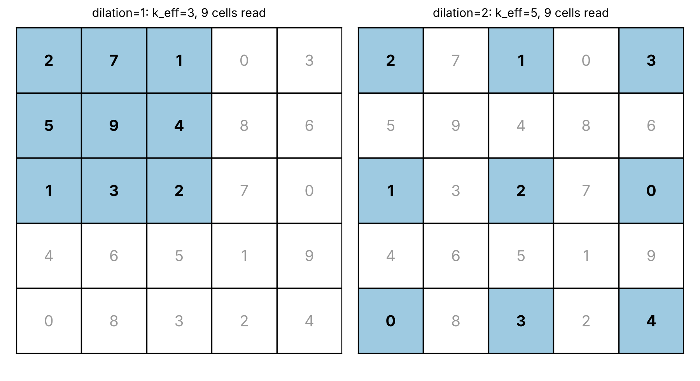

### 1. Dilation : 필터 안에서 읽는 간격

- stride는 **다음 필터를 놓는 간격**
- dilation은 **필터 안에서의 간격**
- 건너뛴 칸은 **계산하지 않는다.**
- 기본 필터는 3×3(가중치 9개)이고, 입력에서 읽는 **범위**만 넓어진다.



### 2. 유효 커널 크기와 출력 크기 계산법

- $k_{eff}$: 필터가 입력에서 실제로 차지하는 길이 (유효 커널 크기)

$$
k_{eff} = d\,(k-1) + 1
$$

- $d$: dilation, $k$: 필터 길이
- 필터 칸이 $k$개, 칸 사이 간격이 $k-1$개, 간격 하나가 $d$칸이라 $d(k-1)$이다. 맨 끝 칸 자신포함 $+1$

- 기존 출력 크기 공식에서 $k$만 $k_{eff}$로 바꾼 것이다.
- $L + 2p < k_{eff}$ → 오류 

$$
L_{out} = \left\lfloor \frac{L + 2p - k_{eff}}{s} \right\rfloor + 1
$$

📍 [예시] $L=5,\ k=3,\ s=1,\ p=0$

| 조건 | $k_{eff}$ | 계산 식 | 출력 길이 |
| :---: | :---: | :---: | :---: |
| **d=1** | $1 \times 2 + 1 = 3$ | $(5 - 3)/1 + 1$ | **3** |
| **d=2** | $2 \times 2 + 1 = 5$ | $(5 - 5)/1 + 1$ | **1** |

### 3. 💻 [코드]

[](https://colab.research.google.com/github/jjuunnee94/jjuunnee94.github.io/blob/main/notebooks/cnn_practice.ipynb)

```python
import torch
from torch import nn

x = torch.tensor([[2., 7., 1., 0., 3.],
                  [5., 9., 4., 8., 6.],
                  [1., 3., 2., 7., 0.],
                  [4., 6., 5., 1., 9.],
                  [0., 8., 3., 2., 4.]]).reshape(1, 1, 5, 5)
K = torch.tensor([[ 1.,  1.,  1.],
                  [ 0.,  0.,  0.],
                  [-1., -1., -1.]])

for d in (1, 2):
    conv = nn.Conv2d(1, 1, kernel_size=3, dilation=d, bias=False)  # dilation 인자만 추가 (기본값 1)
    with torch.no_grad():
        conv.weight.copy_(K.reshape(1, 1, 3, 3))
    out = conv(x)
    print(f"d={d} -> weight {tuple(conv.weight.shape)}, out {tuple(out.shape)}, first {out[0, 0, 0, 0].item()}")
    # weight 모양은 d와 상관없이 그대로 (1, 1, 3, 3) → 가중치 9개 / out은 k_eff 때문에 작아짐
```

```
d=1 -> weight (1, 1, 3, 3), out (1, 1, 3, 3), first 4.0
d=2 -> weight (1, 1, 3, 3), out (1, 1, 1, 1), first -1.0
```

&nbsp;

&nbsp;

\- 이 글은 Codeit 강의를 수강하며 학습한 내용을 바탕으로 개인적으로 정리한 것입니다. ([Codeit 공식 사이트](https://codeit.kr/)) -
{: .small .text-muted .text-center }
