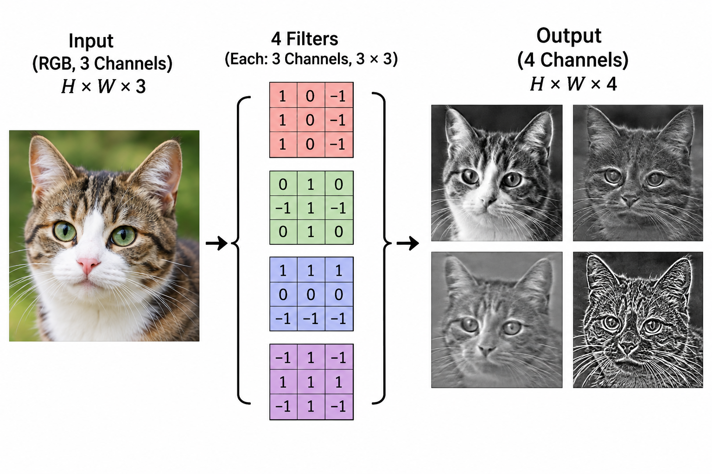

### 1. 여러 채널을 읽는 필터

- 컬러 이미지는 같은 위치에 R, G, B 값이 하나씩 있다. 입력은 `[C, H, W]` = `[3, 높이, 너비]`이다.
- 세 입력 채널을 모두 읽는 출력 필터 **하나**는 입력 채널마다 3×3 가중치 세 묶음을 가진다. (`K_R`, `K_G`, `K_B`)
- 계산 순서
  - 채널마다 패치 × 필터를 곱해서 더한다.
  - 세 기여를 **전부 더한다.**
  - **bias를 한 번** 더한다.
- 이렇게 나온 숫자가 **출력 한 칸**이다. 채널 3개가 출력 채널 3개가 되는 것이 아니다.

🖼️ [그림] 개념 설명용 그림(실제 필터 결과 아님)



### 2. 📍 [예시] 필터 하나로 한 칸 만들기

- 입력 패치 (3×3, 채널 3개), bias = 2

| R | G | B |
| :---: | :---: | :---: |
| 1 &nbsp; 0 &nbsp; 2<br>3 &nbsp; 1 &nbsp; 0<br>0 &nbsp; 2 &nbsp; 1 | 2 &nbsp; 1 &nbsp; 0<br>0 &nbsp; 1 &nbsp; 3<br>1 &nbsp; 0 &nbsp; 2 | 0 &nbsp; 2 &nbsp; 1<br>1 &nbsp; 0 &nbsp; 0<br>2 &nbsp; 1 &nbsp; 1 |

| 채널 | 필터 | 계산 | 기여 |
| :---: | :---: | :---: | :---: |
| **R** | 세로 방향 (1 0 -1) | $(-1) + 3 + (-1)$ | 1 |
| **G** | 가운데만 1 | G의 가운데 값 | 1 |
| **B** | 윗줄 +1, 아랫줄 -1 | $3 - 4$ | -1 |

- 채널 합: $1 + 1 + (-1) = 1$
- bias를 한 번 더한다: $1 + 2 =$ **3**

### 3. 출력 채널 = 출력 필터의 개수

- 필터가 4개이면 같은 입력을 4번 따로 읽어서 특징맵이 4장 나온다. 이 4장이 출력 채널 4개이다.
- 입력 채널은 **색**(R, G, B)이고, 출력 채널은 **필터가 찾은 특징**이다.

| 숫자 | 정하는 방법 |
| :---: | :---: |
| `Cin` (입력 채널) | 입력 데이터에 **맞춰야** 한다. RGB면 3 |
| `Cout` (출력 채널) | **내가 정한다.** 필터 개수 |

### 4. weight 모양과 파라미터 수

- weight는 `[Cout, Cin, kH, kW]`, 입력과 출력은 `[N, C, H, W]` 순서이다.

| 구분 | shape | 읽는 법 |
| :---: | :---: | :---: |
| **입력** | `[N, Cin, H, W]` | 이미지 N장, 채널 Cin |
| **weight** | `[Cout, Cin, kH, kW]` | 필터 Cout개, 각 필터는 채널 Cin장 |
| **bias** | `[Cout]` | 필터마다 하나 |
| **출력** | `[N, Cout, Hout, Wout]` | `Cin`은 합쳐져서 사라진다. |

$$
\text{파라미터 수} = C_{out} \times C_{in} \times k_H \times k_W + C_{out}
$$

📍 [예시]

| 층 | weight | bias | 합계 |
| :---: | :---: | :---: | :---: |
| **Conv2d(3, 4, 3)** | $4 \times 3 \times 3 \times 3 = 108$ | 4 | **112** |
| **Conv2d(3, 16, 5)** | $16 \times 3 \times 5 \times 5 = 1200$ | 16 | **1216** |

- 입력 이미지 수나 크기가 커져도 파라미터 수는 그대로이다. 같은 가중치를 더 많은 위치에서 쓸 뿐이다.
- 입력이 전부 0이어도 출력은 0이 아니다. bias가 더해져서 `y[n, c, h, w] = bias[c]`가 된다.

### 5. 💻 [코드]

[](https://colab.research.google.com/github/jjuunnee94/jjuunnee94.github.io/blob/main/notebooks/cnn_practice.ipynb)

```python
import torch
from torch import nn

x = torch.tensor([[[1., 0., 2.], [3., 1., 0.], [0., 2., 1.]],
                  [[2., 1., 0.], [0., 1., 3.], [1., 0., 2.]],
                  [[0., 2., 1.], [1., 0., 0.], [2., 1., 1.]]]).reshape(1, 3, 3, 3)
# [N, C, H, W] → 이미지 1장, 채널 3개(R, G, B), 3×3
K = torch.tensor([[[ 1., 0., -1.], [ 1., 0., -1.], [ 1., 0., -1.]],
                  [[ 0., 0.,  0.], [ 0., 1.,  0.], [ 0., 0.,  0.]],
                  [[ 1., 1.,  1.], [ 0., 0.,  0.], [-1., -1., -1.]]]).reshape(1, 3, 3, 3)
# [Cout, Cin, kH, kW] → 필터 1개, 채널마다 3×3 가중치

conv = nn.Conv2d(3, 1, kernel_size=3)  # bias=True가 기본값 → 출력 필터마다 bias 1개
with torch.no_grad():
    conv.weight.copy_(K)  # K가 이미 weight와 같은 4축 모양
    conv.bias.fill_(2.)   # bias [1]을 2로 채움

out = conv(x)
print(conv.weight.shape, conv.bias.shape, out.shape, out.item())
# out.item() : 값이 하나뿐인 Tensor를 숫자로 꺼냄
```

```
torch.Size([1, 3, 3, 3]) torch.Size([1]) torch.Size([1, 1, 1, 1]) 3.0
```

```python
layer = nn.Conv2d(3, 4, kernel_size=3, padding=1)

for shape in [(2, 3, 8, 8), (8, 3, 32, 32)]:
    y = layer(torch.zeros(*shape))  # 입력 크기만 바꿔도 같은 layer(같은 가중치)를 사용
    print(shape, '->', tuple(y.shape))

print(layer.weight.shape, layer.bias.shape)
print(sum(p.numel() for p in layer.parameters()))  # weight 108 + bias 4
print((y[0, 2] == layer.bias[2]).all().item())  # 입력이 0이면 출력 채널 2의 모든 칸이 bias[2]
```

```
(2, 3, 8, 8) -> (2, 4, 8, 8)
(8, 3, 32, 32) -> (8, 4, 32, 32)
torch.Size([4, 3, 3, 3]) torch.Size([4])
112
True
```

&nbsp;

&nbsp;

\- 이 글은 Codeit 강의를 수강하며 학습한 내용을 바탕으로 개인적으로 정리한 것입니다. ([Codeit 공식 사이트](https://codeit.kr/)) -
{: .small .text-muted .text-center }
