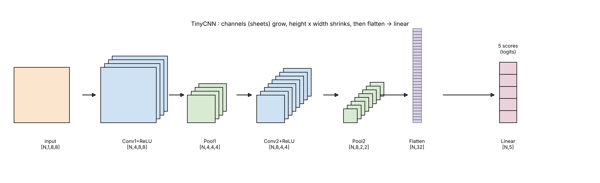

## 1. Flatten

- 특징맵 `[N, C, H, W]` → 배치 크기 `N`은 유지, 나머지만 펼침 `채널 수(C) x 높이(H) x 너비(W)`
- 값의 개수는 그대로, 모양만 바뀜 `[N, C × H × W]`
- Linear는 1차원 입력만 받기 때문에 필요.

📍 **[예시]**

- 입력 `[1, 2, 2, 2]` (값 1~8) → 출력 `[1, 8]`

```python
x = torch.arange(1., 9.).reshape(1, 2, 2, 2)  # 1~8을 [1,2,2,2]로 배치
print(x.flatten(start_dim=1))                 # 0번(N)은 두고 1번부터 펼침
```

```
tensor([[1., 2., 3., 4., 5., 6., 7., 8.]])
```

## 2. Linear

- **핵심 역할:** Flatten으로 펼쳐진 모든 입력값에 **가중치(Weight)를 곱하고 편향(Bias)을 더해서** 점수(Score)를 계산하는 층.
- **파라미터 수 계산:**
  - $(\text{출력 개수} \times \text{입력 개수}) + \text{편향 개수}$ (편향 개수 = 출력 개수)

📍 **[예시]** `Linear(3, 2)`, 입력 `[2, 0, 1]`
- 입력 정보 3개(`in`)를 가중치 2세트(`out`)로 각각 조합하여 **최종 점수 2개**를 만들어 내는 과정.
  - **가중치(Weight):** `[[1, -1, 2], [0, 3, 1]]`  *(출력 2개를 만들기 위한 2세트)*
  - **편향(Bias):** `[1, -2]`

| 출력 구분 | 점수 계산 과정 | 최종 결과 |
| :---: | :---: | :---: |
| **첫 번째 점수 ($j=0$)** | $(1 \times 2) + (-1 \times 0) + (2 \times 1) + 1$ | **$5$** |
| **두 번째 점수 ($j=1$)** | $(0 \times 2) + (3 \times 0) + (1 \times 1) + (-2)$ | **$-1$** |

- **참고:** 여기서 나오는 결과값(`[5, -1]`)은 아직 확률(0~100%)이 아닌, 각 클래스일 가능성을 나타내는 **점수(Logits)**입니다.

## 3. 모델 구조 (nn.Module)

- `__init__` : 사용할 층을 `self.`로 등록
- `forward` : 데이터가 지나가는 순서 작성
- `model(x)` 호출 시 `forward`가 실행됨
- `x = pool(F.relu(conv1(x)))` : 안쪽부터 실행 (conv → relu → pool)

## 4. 💻 [코드]

[](https://colab.research.google.com/github/jjuunnee94/jjuunnee94.github.io/blob/main/notebooks/cnn_practice.ipynb)

```python
import torch
from torch import nn
import torch.nn.functional as F

class TinyCNN(nn.Module):
    def __init__(self):
        super().__init__()                          # 부모 클래스 초기화
        self.conv1 = nn.Conv2d(1, 4, 3, padding=1)  # 채널 1→4, 3x3, 크기 유지
        self.conv2 = nn.Conv2d(4, 8, 3, padding=1)  # 채널 4→8 (앞 출력 4 = 입력 4)
        self.pool = nn.MaxPool2d(2)                 # 2x2 풀링 (가중치 없음, 재사용)
        self.fc = nn.Linear(8 * 2 * 2, 5)           # 펼친 32개 → 5개 점수

    def forward(self, x):
        x = self.pool(F.relu(self.conv1(x)))        # [N,4,8,8] → [N,4,4,4]
        x = self.pool(F.relu(self.conv2(x)))        # [N,8,4,4] → [N,8,2,2]
        x = x.flatten(start_dim=1)                  # [N,8,2,2] → [N,32]
        return self.fc(x)                           # [N,32] → [N,5]

model = TinyCNN()
sample = torch.zeros(3, 1, 8, 8)                    # 이미지 3장, 1채널, 8x8
print(model(sample).shape)                          # 출력 모양 확인
print([sum(p.numel() for p in m.parameters())       # 층별 파라미터 수
       for m in (model.conv1, model.conv2, model.fc)])
print(sum(p.numel() for p in model.parameters()))   # 전체 파라미터 수
```

```
torch.Size([3, 5])
[40, 296, 165]
501
```

🖼️ **[그림]**



| 단계 | 모양 | 계산 |
|:---:|:---:|:---:|
| 입력 | `[N,1,8,8]` | |
| Conv1 + ReLU | `[N,4,8,8]` | padding=1이라 크기 유지 |
| Pool1 | `[N,4,4,4]` | 8 → 4 |
| Conv2 + ReLU | `[N,8,4,4]` | |
| Pool2 | `[N,8,2,2]` | 4 → 2 |
| Flatten | `[N,32]` | $8\times2\times2$ |
| Linear | `[N,5]` | 5개 클래스 점수 |

## 5. 파라미터 수

- ReLU, Pooling, Flatten은 파라미터 없음
- 배치 크기, 출력 위치 수는 곱하지 않음

| 층 | 계산 | 개수 |
|:---:|:---:|:---:|
| conv1 | $4\times(1\times3\times3+1)$ | 40 |
| conv2 | $8\times(4\times3\times3+1)$ | 296 |
| fc | $5\times(32+1)$ | 165 |
| 합계 | | **501** |

&nbsp;

&nbsp;

이 글은 Codeit 강의를 수강하며 학습한 내용을 바탕으로 개인적으로 정리한 것입니다. ([Codeit 공식 사이트](https://codeit.kr/))
{: .small .text-muted .text-center }
