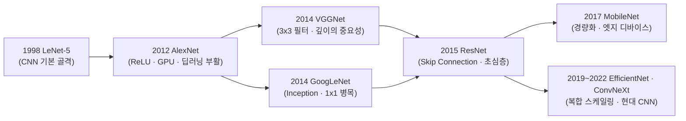
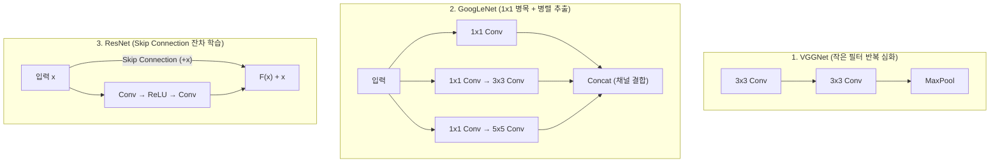

### 1. CNN 발전의 핵심 질문과 전체 흐름

- CNN(Convolutional Neural Network)의 역사는 **"어떻게 망을 더 깊게 쌓으면서도 연산량 폭증과 기울기 소실(Vanishing Gradient)을 막을 것인가?"**를 해결해 온 과정이다.
- 1998년 LeNet-5로 기초 골격이 탄생한 이후, 2012년 ImageNet 대회(ILSVRC)를 기점으로 폭발적인 구조 혁신이 일어났다.

  

    

      <strong style="font-size: 1.05rem;">📊 CNN 아키텍처 진화 인터랙티브 탐색기</strong>
      
원(버블) 또는 아래 모델 버튼을 클릭해 구조와 성능을 비교해 보세요.

    

    

      <button type="button" data-filter="all" style="padding: 5px 10px; border-radius: 6px; border: 1px solid #3b82f6; background: #3b82f6; color: #fff; font-size: 0.8rem; cursor: pointer;">전체 (7)</button>
      <button type="button" data-filter="accuracy" style="padding: 5px 10px; border-radius: 6px; border: 1px solid rgba(128,128,128,0.4); background: transparent; color: inherit; font-size: 0.8rem; cursor: pointer;">정확도·심화</button>
      <button type="button" data-filter="efficiency" style="padding: 5px 10px; border-radius: 6px; border: 1px solid rgba(128,128,128,0.4); background: transparent; color: inherit; font-size: 0.8rem; cursor: pointer;">효율·경량화</button>
    

  

  

    <svg id="cnn-bubble-svg" viewBox="0 0 680 270" style="width: 100%; min-width: 520px; height: auto; display: block;">
      <line x1="65" y1="20" x2="65" y2="225" stroke="currentColor" stroke-opacity="0.25" />
      <line x1="65" y1="225" x2="650" y2="225" stroke="currentColor" stroke-opacity="0.25" />

      <text x="55" y="25" font-size="11" text-anchor="end" fill="currentColor" opacity="0.7">18%</text>
      <line x1="65" y1="22" x2="650" y2="22" stroke="currentColor" stroke-opacity="0.08" stroke-dasharray="3,3" />

      <text x="55" y="92" font-size="11" text-anchor="end" fill="currentColor" opacity="0.7">12%</text>
      <line x1="65" y1="89" x2="650" y2="89" stroke="currentColor" stroke-opacity="0.08" stroke-dasharray="3,3" />

      <text x="55" y="160" font-size="11" text-anchor="end" fill="currentColor" opacity="0.7">6%</text>
      <line x1="65" y1="157" x2="650" y2="157" stroke="currentColor" stroke-opacity="0.08" stroke-dasharray="3,3" />

      <line x1="65" y1="168" x2="650" y2="168" stroke="#ef4444" stroke-width="1.2" stroke-dasharray="5,4" />
      <text x="645" y="163" font-size="10.5" text-anchor="end" fill="#ef4444" font-weight="bold">인간 인지 한계 (~5.0%)</text>

      <text x="55" y="228" font-size="11" text-anchor="end" fill="currentColor" opacity="0.7">0%</text>
      <text x="18" y="125" font-size="11" text-anchor="middle" fill="currentColor" opacity="0.75" transform="rotate(-90, 18, 125)">ImageNet Top-5 에러율 (낮을수록 우수)</text>

      <text x="105" y="245" font-size="11" text-anchor="middle" fill="currentColor" opacity="0.75">1998</text>
      <text x="200" y="245" font-size="11" text-anchor="middle" fill="currentColor" opacity="0.75">2012</text>
      <text x="315" y="245" font-size="11" text-anchor="middle" fill="currentColor" opacity="0.75">2014</text>
      <text x="425" y="245" font-size="11" text-anchor="middle" fill="currentColor" opacity="0.75">2015</text>
      <text x="525" y="245" font-size="11" text-anchor="middle" fill="currentColor" opacity="0.75">2017</text>
      <text x="615" y="245" font-size="11" text-anchor="middle" fill="currentColor" opacity="0.75">2019</text>

      <g id="cnn-bubbles-layer"></g>
    </svg>
  

  
* 원(버블)의 크기는 모델의 파라미터 수(백만 개)에 비례합니다. (LeNet-5는 MNIST 기준)

  

  

    

      
      
    

    
<strong>💡 핵심 돌파구:</strong> 

    
<strong>🎯 해결한 문제:</strong> 

    

      <strong>[블록 구조]</strong> 
    

  

🔍[비교] 시대별 대표 CNN 아키텍처 요약

| 모델명 | 연도 | 층 수 | 핵심 아이디어 (대표 키워드) | 파라미터 수 (약) | 의의 |
|:---:|:---:|:---:|:---|:---:|:---|
| **LeNet-5** | 1998 | 5 | `Conv - Pool - FC` 기본 구조 정립 | 6만 개 | 현대 CNN의 원형 |
| **AlexNet** | 2012 | 8 | `ReLU`, `Dropout`, 멀티 GPU 학습 | 6,000만 개 | 딥러닝 르네상스의 시발점 |
| **VGG-16** | 2014 | 16 | **3×3 필터 통일** + 네트워크 심화 | 1억 3,800만 개 | 깊이의 중요성 입증, 깔끔한 구조 |
| **GoogLeNet** | 2014 | 22 | **Inception 모듈**, **`1×1 Conv` 병목**, GAP | 680만 개 | 연산 효율 극대화 (가로 확장) |
| **ResNet-50** | 2015 | 50 | **Skip Connection (잔차 학습)** | 2,560만 개 | 초심층(100층 이상) 학습 가능 |
| **EfficientNet-B0** | 2019 | - | **Compound Scaling** (깊이·너비·해상도 균형) | 530만 개 | 연산량 대비 최고 정확도 달성 |

> **핵심 성능 변곡점 요약**
> - **VGG-16 → GoogLeNet**: 파라미터 수가 **1억 3,800만 개 → 680만 개(약 1/20)**로 줄면서 정확도는 오히려 상승했다.
> - **GoogLeNet → ResNet**: 인간의 이미지 분류 인지 한계(Top-5 에러율 약 5%)를 **3.57%**로 처음 돌파했다.
{: .prompt-tip }

### 2. 1998년 ~ 2012년: 태동과 딥러닝 르네상스

- **LeNet-5 (1998, Yann LeCun)**
  - 손글씨 우편번호(MNIST) 인식을 위해 개발된 5개 학습 층 구조로 **현대 CNN의 시초**이다.
  - `Conv(합성곱) → Subsampling(풀링) → FC(완전연결층)`로 이어지는 표준 파이프라인을 최초로 정립했다.
  - 당시 컴퓨팅 파워(CPU)의 한계와 활성 함수(`tanh`, `sigmoid`)로 인한 기울기 소실 문제로 고해상도 이미지 처리에는 한계가 있었다.

- **AlexNet (2012, Alex Krizhevsky 외)**
  - ImageNet 대회(ILSVRC 2012)에서 기존 전통 머신러닝 기법을 압도적인 격차(Top-5 에러율 26% → 15.3%)로 꺾고 우승하며 **딥러닝 시대를 열었다.**
  - **GPU 병렬 연산**을 최초로 도입해 대규모 데이터 학습을 가능하게 했다.
  - **`ReLU` 활성 함수**를 채택해 기울기 소실 문제를 완화하고 학습 속도를 6배 이상 높였다.
  - **`Dropout`**과 **데이터 증강(Data Augmentation)** 기법으로 과적합을 효과적으로 억제했다.

### 3. 2014년 ~ 2015년: 핵심 3대 블록 구조의 진화 (VGG · GoogLeNet · ResNet)

CNN 아키텍처의 가장 중요한 전환점은 **블록(Block) 내부 설계 방식**의 변화에 있다.

- **VGGNet (2014 ILSVRC 준우승, 옥스퍼드 대학 VGG 팀)**
  - **"작은 필터를 깊게 쌓자"**는 철학으로 네트워크의 **깊이(Depth)**가 성능에 미치는 영향을 입증했다.
  - 기존 AlexNet의 큰 필터(11×11, 5×5)를 버리고 **오직 3×3 필터만 16~19층(VGG-16, VGG-19)으로 깊게 쌓았다.**
  - 3×3 필터를 2번 겹치면 5×5 필터 1번과 수용 영역(Receptive Field)은 같지만, **파라미터 수는 줄어들고 비선형성(ReLU)은 2배로 증가**해 표현력이 높아진다.

> **VGGNet의 한계점**
> 모델 뒤쪽 완전연결층(FC Layer)에 전체 파라미터의 약 85%(약 1억 2,000만 개)가 집중되어 모델 용량이 무겁고 학습 시간이 오래 걸린다.
{: .prompt-warning }

- **GoogLeNet / Inception-v1 (2014 ILSVRC 우승, 구글)**
  - **"가로로 넓히고 연산량을 줄이자"**는 전략으로 **Inception 모듈**을 도입했다.
  - 한 층에서 1×1, 3×3, 5×5 합성곱과 3×3 풀링을 **병렬로 동시에 수행**한 뒤 결과를 합쳐 다양한 크기의 특징(Multi-scale)을 포착한다.
  - **핵심 무기 (`1×1 Convolution` 병목 구조)**: 3×3이나 5×5 연산 직전에 `1×1 합성곱`을 배치해 채널(깊이) 수를 압축함으로써 **연산량을 획기적으로 절감**했다.
  - 무거운 FC 층 대신 **GAP(Global Average Pooling)**를 도입해 22층으로 깊어졌음에도 파라미터 수는 VGGNet의 약 1/12 수준(약 680만 개)으로 줄였다.

- **ResNet (2015 ILSVRC 우승, 마이크로소프트 Kaiming He 외)**
  - Top-5 에러율 3.57%를 기록하며 **인간의 이미지 분류 인지 능력(약 5%)을 최초로 뛰어넘었다.**
  - 망을 20층 이상 깊게 쌓으면 오히려 학습 에러가 커지는 **성능 저하(Degradation) 문제**를 해결하며 152층까지 쌓는 데 성공했다.
  - **핵심 발명 (`Skip Connection` / 잔차 학습)**: 입력값 $x$를 출력에 그대로 더해주는 지름길($H(x) = F(x) + x$)을 연결했다.

> **왜 Skip Connection이 효과적인가?**
> 신경망이 전체 출력 $H(x)$를 처음부터 새로 학습하는 대신 **입력과의 차이(잔차, $F(x) = H(x) - x$)**만 학습하도록 유도해 최적화 난이도를 낮추며, 역전파(Backpropagation) 시 기울기가 소실되지 않고 앞단까지 직접 흐르는 고속도로 역할을 한다.
{: .prompt-info }

### 4. 2017년 ~ 2022년: 경량화와 현대 CNN의 완성

- **DenseNet (2017)**: 이전 모든 층의 특징 맵(Feature Map)을 다음 층에 덧셈이 아닌 **채널 방향 결합(`Concat`)**으로 연결해 특징 재사용성을 극대화했다.
- **MobileNet (2017)**: 일반 합성곱을 공간 연산(Depthwise)과 채널 연산(Pointwise, 1×1)으로 쪼갠 **Depthwise Separable Convolution**을 도입해 스마트폰·엣지 디바이스에서도 실시간으로 동작하는 초경량 CNN 시대를 열었다.
- **EfficientNet (2019)**: 네트워크의 **깊이(Depth), 너비(Width), 입력 해상도(Resolution)** 세 가지를 균형 있게 동시에 키우는 **복합 스케일링(Compound Scaling)**으로 연산량 대비 최고 효율을 달성했다.
- **ConvNeXt (2022)**: Vision Transformer(ViT)의 설계 철학(7×7 큰 커널, LayerNorm, 역병목 구조 등)을 순수 CNN 구조에 역수입하여 최신 Transformer 계열과 대등한 성능을 입증했다.

### 5. 핵심 기술 흐름 요약

- **필터 크기의 축소 (`VGGNet`)**: 큰 필터 1개 대신 **작은 3×3 필터 여러 개**를 쌓아 파라미터는 줄이고 비선형성은 높인다.
- **차원 축소와 연산 최적화 (`GoogLeNet`)**: **`1×1 합성곱`**으로 채널 수를 압축한 뒤 무거운 연산을 수행하고, 마지막 FC 층을 **GAP**로 대체한다.
- **기울기 소실 해결과 초심층화 (`ResNet`)**: **`Skip Connection` ($F(x) + x$)**으로 100층 이상의 깊은 네트워크 학습을 가능하게 한다.
- **모바일 경량화 (`MobileNet`)**: 연산을 깊이별(Depthwise)과 점별(Pointwise)로 분리해 연산량을 대폭 줄인다.

&nbsp;

&nbsp;

\- 이 글은 Codeit 강의를 수강하며 학습한 내용을 바탕으로 개인적으로 공부한 것입니다. ([Codeit 공식 사이트](https://codeit.kr/)) -
{: .small .text-muted .text-center }
